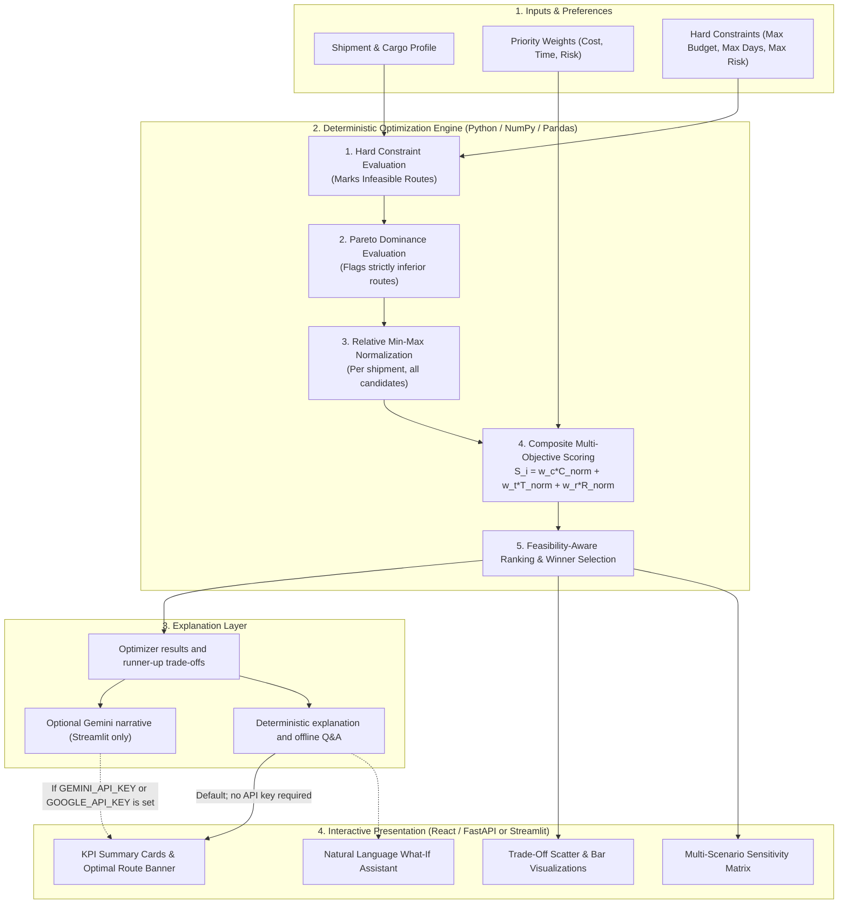

# 🚢 RouteWise AI — Intelligent Shipment Route Decision Support System

[](https://www.python.org/downloads/)
[](tests/)
[](frontend/)
[](reports/technical_report.pdf)

> **Submission for Aiqon AI Internship Take-Home Assignment**  
> *Optimizing Shipment Routes Under Cost, Time, and Risk Constraints*

---

## 📌 Executive Summary

**RouteWise AI** is a decision-support prototype for comparing shipment options under cost, transit-time, and risk priorities. A deterministic Python optimizer evaluates the candidate services and recommends an option based on configurable weights and optional hard limits. The primary demo is a React + TypeScript interface backed by FastAPI; a Streamlit dashboard is also available. Dataset values, risk indicators, carrier labels, and map curves are illustrative planning data—not live quotes, measured carrier performance, or navigable routes.

## ✅ Assignment Requirement Check

| Assignment requirement | Implementation and evidence | Status / boundary |
|---|---|---|
| Evaluate 3–5 options for 20–50 shipments | Seeded benchmark has 30 shipment lanes and 4 alternatives per lane (120 rows); verified in `tests/test_data.py`. | Met with synthetic data |
| Recommend using cost, time and risk | `src/optimizer.py` normalizes these metrics within each shipment, applies configurable weights, tests hard limits and ranks feasible routes first. | Met; scores compare routes within a lane, not between lanes |
| Explain the selected option against alternatives | `src/explanations.py` reports the recommendation, runner-up trade-offs, feasibility and dominance; both UIs expose the rationale. | Met; explanations reflect model inputs |
| Address risk and uncertainty | Four weight profiles support sensitivity analysis; delay, congestion and geopolitical indicators feed a composite risk score. | Partially met; indicators are synthetic point estimates, not calibrated probability distributions |
| Evaluate system behavior | Tests cover data shape/ranges, pricing examples, scoring, constraints, fallback, Pareto flags, sensitivity and map behavior. | Engineering verification only; no historical backtest or carrier-quote validation |
| Supply repository instructions, technical report and demo | This README documents setup and assumptions; `reports/technical_report.pdf` is the generated three-page report; React/FastAPI is the primary demo and Streamlit is an alternate interface. | Included |

---

## 🏛️ System Architecture



---

## 📐 Mathematical Decision Framework

### 1. Relative Normalization (Per-Shipment Candidate Pool)
Cost, transit time and composite risk are normalized relative to **all candidate routes for that shipment** (including options later marked infeasible):
$$\hat{C}_i = \frac{C_i - C_{\min}}{C_{\max} - C_{\min} + \epsilon}$$
$$\hat{T}_i = \frac{T_i - T_{\min}}{T_{\max} - T_{\min} + \epsilon}$$
*Where $\epsilon = 10^{-6}$. If all candidate values for a criterion are equal, its normalized value is set to zero. Scores compare alternatives within one shipment, not across shipments.*

### 2. Composite Risk Index
Logistics risk combines operational delay probability, port congestion, and geopolitical friction:
$$\hat{R}_i = 0.40 \cdot P(\text{delay}) + 0.30 \cdot \left(\frac{\text{Congestion}}{100}\right) + 0.30 \cdot \left(\frac{\text{Geopolitical}}{100}\right)$$
$$\hat{R}_{\text{norm}, i} = \frac{\hat{R}_i - \hat{R}_{\min}}{\hat{R}_{\max} - \hat{R}_{\min} + \epsilon}$$

### 3. Total Weighted Score (Minimization)
$$S_i = w_c \cdot \hat{C}_i + w_t \cdot \hat{T}_i + w_r \cdot \hat{R}_{\text{norm}, i} \quad \text{subject to } w_c + w_t + w_r = 1.0$$
*Lower score indicates superior multi-objective trade-off performance.*

### 4. Hard Constraints & Infeasibility Fallback
* Marks routes infeasible when freight cost exceeds the maximum budget, transit time exceeds the maximum days, or composite risk exceeds the maximum risk.
* Feasible routes rank ahead of infeasible routes. If **all** candidates are infeasible, best effort chooses the route with the fewest violated limits, then the lowest weighted score, and displays the violations.
* An expected-delay diagnostic is calculated as `transit_days × delay_probability × 0.25`; expected landed cost adds an illustrative USD 4 per expected delay day to freight cost. **Neither diagnostic affects ranking or budget feasibility.** Recommendations minimize weighted freight cost, time, and risk—not total landed cost.

### 5. Pareto Dominance
Route $A$ strictly dominates Route $B$ ($A \succ B$) if:
$$C_A \le C_B \land T_A \le T_B \land R_A \le R_B \land (C_A < C_B \lor T_A < T_B \lor R_A < R_B)$$
Dominated routes are flagged for operator review; they are not removed from the candidate list.

### 6. Limits of the estimates and map
The 30 synthetic lanes comprise 18 domestic India lanes and 12 international lanes, each with four service archetypes (120 options). Costs model a 10 kg domestic carton or a 15 kg / 0.1 CBM export sample, with a fixed INR 84/USD display conversion. These values are planning estimates only: no live carrier quote, historical delay, pickup/cutoff, dimensional-weight, customs, duty or tax data is used. Seeded variation is ±6% on cost, ±7% on domestic transit time, and ±6% on international transit time. Cargo profile labels are descriptive and currently do not change the rate formula or weights.

Risk probabilities and indicators are synthetic point estimates, not calibrated forecasts. Carrier and service names are illustrative labels and do not represent quotes, availability, or endorsements. Both maps place only known origin/destination endpoints and use schematic curves to distinguish alternatives; they do **not** show carrier-approved paths or live traffic. Unknown locations are intentionally not assigned invented map coordinates. The natural-language corridor parser uses a fixed city/alias list; where it cannot resolve a city, its deterministic pricing-distance fallback is not a geocoded distance.

Unit tests check deterministic behavior and selected estimator boundaries, not real-world price accuracy or recommendation quality. No historical backtest or carrier-quote validation has been performed.

---

## 🚀 Quickstart & Setup

### 1. Prerequisites
* Python 3.10 or later (verified here with Python 3.13.3)
* Node.js 18 or later and npm
* Git

### 2. Installation
```bash
# Clone the repository
git clone https://github.com/UshaSri26/routewise-ai-.git
cd routewise-ai-

# Create and activate a virtual environment (Windows PowerShell)
python -m venv .venv
.\.venv\Scripts\Activate.ps1

# Install Python dependencies
python -m pip install -r requirements.txt
```

### 3. Run the primary React application

The intended demo interface is the React frontend backed by FastAPI. Open two terminals from the repository root:

```bash
# Terminal 1 — Python API
python -m uvicorn api:app --reload --port 8000

# Terminal 2 — React frontend
cd frontend
npm install
npm run dev
```

Open `http://localhost:3000`. The API docs are available at `http://localhost:8000/docs`.

The primary React demo includes the shipment overview, configurable route optimizer, endpoint corridor comparison map, four-profile sensitivity view, deterministic Q&A assistant, and methodology page. The map uses schematic comparison curves, not live carrier routes. The frontend calls these FastAPI endpoints: `/api/shipments`, `/api/optimize`, `/api/custom-optimize`, `/api/scenarios/{shipment_id}`, `/api/ask`, and `/api/health`.

Route prices are planning estimates for a 10 kg domestic carton or a 15 kg / 0.1 CBM
international sample. They include modeled handling allowances, but are not live
carrier quotes and exclude customs duties and taxes. Cargo labels do not currently change
the pricing formula.

The React app uses the deterministic optimizer and offline assistant by default and does
not need an AI API key. The optional Gemini-backed explanation available to the Streamlit
app can use `GEMINI_API_KEY` or `GOOGLE_API_KEY` in the process environment; do not commit
API keys to the repository.

### 4. Optional: run the alternate Streamlit dashboard

The original Streamlit interface is retained as an alternate dashboard:

```bash
streamlit run app.py
```

Open your browser at `http://localhost:8501`.

### 5. Run the Unit Test Suite
```bash
pytest -v
```
Current verified result: `19 passed`.

### 6. Re-generate Technical Report PDF
```bash
python -m reports.generate_report
```
The resulting three-page assignment report is saved to `reports/technical_report.pdf`.

---

## 📦 Project Structure

```
routewise-ai/
├── api.py                      # FastAPI service for React
├── app.py                      # Interactive Streamlit application
├── requirements.txt            # Project dependencies
├── pytest.ini                  # Pytest configuration
├── README.md                   # Complete system documentation
├── frontend/                   # React + TypeScript + Vite application
│   ├── package.json            # Frontend scripts and dependencies
│   └── package-lock.json       # Locked frontend dependency versions
├── src/
│   ├── __init__.py
│   ├── custom_shipment.py      # Heuristic prompt parsing and corridor generation
│   ├── freight_costs.py        # Synthetic parcel/sample pricing assumptions
│   ├── data_generator.py       # Seeded synthetic dataset generator (30 shipments x 4 routes)
│   ├── money.py                # Currency display helpers
│   ├── optimizer.py            # Mathematical optimizer, constraints & Pareto dominance
│   ├── explanations.py         # Deterministic explanations and optional Gemini integration
│   └── views/
│       └── map_component.py    # Streamlit endpoint map with schematic alternatives
├── tests/
│   ├── __init__.py
│   ├── test_optimizer.py       # Scoring, constraints, fallback, Pareto and explanations
│   ├── test_data.py            # Tests for dataset completeness and schema
│   ├── test_custom_shipment.py # Tests for indicative small-shipment pricing
│   └── test_map_component.py   # Map behavior and unknown-coordinate regressions
├── data/
│   └── shipments.csv           # 120 route options across 30 global trade lanes
└── reports/
    ├── generate_report.py      # Reproducible report builder (ReportLab)
    └── technical_report.pdf    # 3-page assignment report
```

---

## 📊 Benchmark Dataset Details

The generated dataset contains **30 lanes (18 India domestic, 12 international)** and four service options per lane. Domestic choices are rail parcel, surface truck, express road, and priority road/air. International choices are standard ocean, express ocean, resilient ocean, and air. Benchmark estimates are deterministic formula-based values with seeded cost variation (±6%); transit-time variation is ±7% for domestic and ±6% for international lanes. See `src/freight_costs.py` for the assumptions and formulas.

---

## 🔍 Key Findings & Sensitivity Analysis

| Benchmark shipment | Balanced | Cost-focused | Time-critical and risk-averse |
|---|---|---|---|
| **SHP-001 Hyderabad–Warangal** | Rail parcel: $2.61, 0.178 days | Rail parcel: $2.61, 0.178 days | Priority courier: $9.29, 0.103 days |
| **SHP-019 Shanghai–Rotterdam** | Resilient ocean: $239.65, 28.6 days | Resilient ocean: $239.65, 28.6 days | Air: $463.17, 4 days |

These are seeded synthetic benchmark outputs, not evidence that those services are actually fastest, cheapest, or safest. The risk-averse choices reflect the risk scores assigned to each archetype.

---

## ⚠️ Real-World Limitations & Production Roadmap

1. **Synthetic prices and service levels:** Replace fixed parcel/sample formulas with carrier rates, package dimensions, service areas, handling, fuel and pickup/cutoff rules.
2. **Expected cost is not optimized:** The illustrative delay-cost diagnostic is not currently part of ranking or budget checks. Calibrate delay consequences with customers and include validated expected landed cost where appropriate.
3. **Static risk scores:** Integrate timestamped carrier, port, weather and tracking data; calibrate uncertainty using historical outcomes before calling risk estimates predictive.
4. **Schematic map:** Obtain carrier-approved route geometries and traffic data before rendering paths as navigable routes.

---

## 👥 Author & Submission Info
* **Assignment:** Aiqon AI Internship take-home assignment
* **Deliverables in this repository:** Source code, setup instructions, tests, interactive demo, and [three-page technical report](reports/technical_report.pdf).
* **Submission contact from assignment brief:** `info@aiqon.in`
