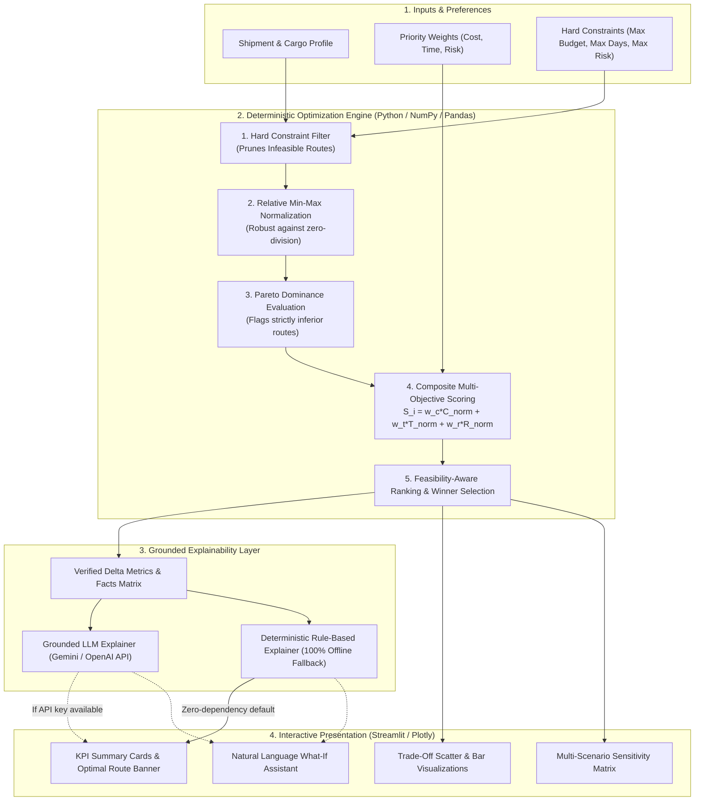

# 🚢 RouteWise AI — Intelligent Shipment Route Decision Support System

[](https://www.python.org/downloads/release/python-3110/)
[](tests/)
[](app.py)
[](reports/technical_report.pdf)

> **Submission for Aiqon AI Internship Take-Home Assignment**  
> *Optimizing Shipment Routes Under Cost, Time, and Risk Constraints*

---

## 📌 Executive Summary

In global logistics, choosing a shipping route is rarely a matter of picking the shortest or cheapest path. Slower routes frequently accumulate demurrage, congestion, and chokepoint delays, while express air/multimodal routes carry unsustainable cost premiums.

**RouteWise AI** is a decision-support system featuring a **deterministic multi-criteria optimization engine** at its core and a **grounded explainable AI assistant** as its interaction layer.

Instead of letting an LLM hallucinate numerical trade-offs, the optimization core deterministically computes scores, enforces hard business constraints, flags Pareto-dominated routes, and feeds verified facts into the explainability engine.

---

## 🏛️ System Architecture



---

## 📐 Mathematical Decision Framework

### 1. Relative Normalization (Per-Shipment Candidate Pool)
Attributes are normalized relative to available alternatives for that specific shipment corridor:
$$\hat{C}_i = \frac{C_i - C_{\min}}{\max(C_{\max} - C_{\min}, \epsilon)}$$
$$\hat{T}_i = \frac{T_i - T_{\min}}{\max(T_{\max} - T_{\min}, \epsilon)}$$
*Where $\epsilon = 10^{-6}$ provides numerical stability when candidate values are identical.*

### 2. Composite Risk Index
Logistics risk combines operational delay probability, port congestion, and geopolitical friction:
$$\hat{R}_i = 0.40 \cdot P(\text{delay}) + 0.30 \cdot \left(\frac{\text{Congestion}}{100}\right) + 0.30 \cdot \left(\frac{\text{Geopolitical}}{100}\right)$$
$$\hat{R}_{\text{norm}, i} = \frac{\hat{R}_i - \hat{R}_{\min}}{\max(\hat{R}_{\max} - \hat{R}_{\min}, \epsilon)}$$

### 3. Total Weighted Score (Minimization)
$$S_i = w_c \cdot \hat{C}_i + w_t \cdot \hat{T}_i + w_r \cdot \hat{R}_{\text{norm}, i} \quad \text{subject to } w_c + w_t + w_r = 1.0$$
*Lower score indicates superior multi-objective trade-off performance.*

### 4. Hard Constraints & Infeasibility Fallback
* Disqualifies routes violating $C_i \le C_{\max}$, $T_i \le T_{\max}$, or $R_i \le R_{\max}$.
* If **all** candidates violate constraints, the system activates a **Best-Effort Fallback Mode** with diagnostic violation banners rather than crashing.

### 5. Pareto Dominance
Route $A$ strictly dominates Route $B$ ($A \succ B$) if:
$$C_A \le C_B \land T_A \le T_B \land R_A \le R_B \land (C_A < C_B \lor T_A < T_B \lor R_A < R_B)$$
Dominated routes are flagged to prevent suboptimal choices.

---

## 🚀 Quickstart & Setup

### 1. Prerequisites
* Python 3.10 or 3.11
* Git

### 2. Installation
```bash
# Clone the repository
git clone https://github.com/YOUR_USERNAME/routewise-ai.git
cd routewise-ai

# Install dependencies
pip install -r requirements.txt
```

### 3. Run the Interactive Dashboard
```bash
streamlit run app.py
```
Open your browser at `http://localhost:8501`.

### 4. Run the Unit Test Suite
```bash
pytest -v
```
Output:
```
tests/test_data.py::test_dataset_generation_shape PASSED
tests/test_data.py::test_dataset_value_ranges PASSED
tests/test_optimizer.py::test_weights_validation PASSED
tests/test_optimizer.py::test_polar_weight_cost PASSED
tests/test_optimizer.py::test_polar_weight_time PASSED
tests/test_optimizer.py::test_polar_weight_risk PASSED
tests/test_optimizer.py::test_hard_constraint_budget_exclusion PASSED
tests/test_optimizer.py::test_hard_constraint_transit_time PASSED
tests/test_optimizer.py::test_all_infeasible_graceful_fallback PASSED
tests/test_optimizer.py::test_pareto_dominance_detection PASSED
tests/test_optimizer.py::test_identical_metrics_zero_division PASSED
tests/test_optimizer.py::test_sensitivity_analysis_structure PASSED
tests/test_optimizer.py::test_rule_based_explainer PASSED
============== 13 passed in 1.63s ==============
```

### 5. Re-generate Technical Report PDF
```bash
python -m reports.generate_report
```
The resulting 3-page publication PDF is saved to `reports/technical_report.pdf`.

---

## 📦 Project Structure

```
routewise-ai/
├── app.py                      # Interactive Streamlit application
├── requirements.txt            # Project dependencies
├── pytest.ini                  # Pytest configuration
├── README.md                   # Complete system documentation
├── src/
│   ├── __init__.py
│   ├── data_generator.py       # Seeded synthetic dataset generator (30 shipments x 4 routes)
│   ├── optimizer.py            # Mathematical optimizer, constraints & Pareto dominance
│   └── explanations.py         # Dual-mode explainability (Grounded LLM + Deterministic Fallback)
├── tests/
│   ├── __init__.py
│   ├── test_optimizer.py       # 11 unit tests covering all mathematical edge cases
│   └── test_data.py            # Tests for dataset completeness and schema
├── data/
│   └── shipments.csv           # 120 route options across 30 global trade lanes
└── reports/
    ├── generate_report.py      # Automated PDF report builder (ReportLab)
    └── technical_report.pdf    # 3-page submission report for Aiqon
```

---

## 📊 Benchmark Dataset Details

The synthetic dataset (`data/shipments.csv`) simulates **30 global shipments** across international trade corridors (Asia–Europe, Trans-Pacific, South Asia–Europe, Latin America–Europe). Each shipment features 4 distinct route archetypes:

1. **Economic Standard Ocean:** Lowest direct freight cost, higher transit duration, higher port congestion (e.g., via Suez / Singapore).
2. **Express Direct Ocean:** Faster transit, premium ocean rate, reduced port calls.
3. **Resilient Cape Diversion:** Bypasses geopolitical conflict zones (Cape of Good Hope); slightly longer nautical route, very low delay risk.
4. **Multimodal Sea-Air Express:** Premium speed (7-9 days vs 28 days), highest cost; ideal for critical JIT or cold-chain cargo.

---

## 🔍 Key Findings & Sensitivity Analysis

| Operational Priority | Weight Profile (Cost/Time/Risk) | Typical Winner Archetype | Key Trade-off Justification |
|---|---|---|---|
| **Balanced** | 40% / 30% / 30% | Express Direct Ocean | 25% faster transit & low congestion outweigh modest cost premium. |
| **Cost-Focused** | 70% / 15% / 15% | Economic Standard Ocean | Captures absolute lowest freight rate; accepts 7-10 extra transit days. |
| **Time-Critical** | 15% / 70% / 15% | Multimodal Sea-Air | Slashes transit time from 28d to 8d; cost premium justified by urgency. |
| **Risk-Averse** | 15% / 15% / 70% | Resilient Cape Diversion | Bypasses high-risk maritime chokepoints; maximizes schedule certainty. |

---

## ⚠️ Real-World Limitations & Production Roadmap

1. **Static vs. Live Dynamic Feeds:** The current model evaluates simulated risk scores. A production deployment would ingest live AIS vessel tracking (Spire / MarineTraffic) and weather forecasts.
2. **Step-Function Demurrage Costs:** Port demurrage and detention fees behave as non-linear step functions after free-time expires. Future extensions should incorporate piecewise penalty functions.
3. **Stochastic Optimization:** Real-world maritime delays follow skewed distributions (e.g., log-normal). Upgrading the deterministic scoring engine to Monte Carlo chance-constrained optimization will model long-tail tail risk.

---

## 👥 Author & Submission Info
* **Candidate:** Submitted for Aiqon AI Internship (Take-Home Assignment)
* **Deliverables:** GitHub Repository, [Technical Report (PDF)](reports/technical_report.pdf), Interactive Demo.
* **Submission Contact:** `info@aiqon.in`
